# Relic Revival Run

<p align="center">
  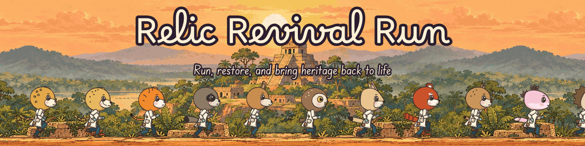
</p>

<p align="center">
  <a href="https://github.com/e-choness/relic-revival-run/actions/workflows/ci.yml"></a>
  <a href="https://github.com/e-choness/relic-revival-run/commits"></a>
  <a href="https://github.com/e-choness/relic-revival-run"></a>
  <a href="https://paoowo.itch.io/relic-revival-run"></a>
  <br>
  
  
  
  
  
  <br>
  <a href="LICENSE"></a>
  <a href="LICENSE-ASSETS"></a>
  <a href="media/README.md"></a>
</p>

<p align="center"><b>Run, restore, and bring heritage back to life.</b></p>

<p align="center">
  <a href="#a-look-inside">A look inside</a> ·
  <a href="#features">Features</a> ·
  <a href="#controls">Controls</a> ·
  <a href="#the-twelve-cultures">Cultures</a> ·
  <a href="#development">Development</a> ·
  <a href="media/README.md">Media kit</a> ·
  <a href="#the-original-2023">The original</a>
</p>

A runner about restoring cultural heritage. Play as an animal art restorer and run through twelve cultures, from Mexico and Portugal to Mali. Use the right conservation tool on each kind of damage to bring masterpieces back to life.

This is a **remake** by Echo Yin of the 2023 game-jam original by **Studio Jojo**, made for the [Mini Game Work Jam](https://itch.io/jam/mini-game-work-jam-2023), a jam that advocates against the illicit traffic of cultural property.
- **What carries over:** the remake builds on the original's concept and design.
- **What's new:** it is a new web-based build, and most of the original assets are not part of it.

## A look inside

<p align="center">
  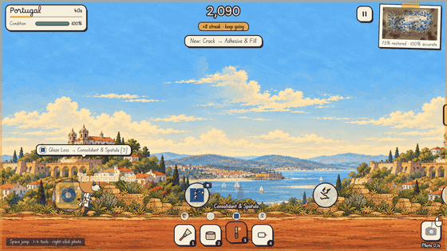
</p>

| | |
|:---:|:---:|
| 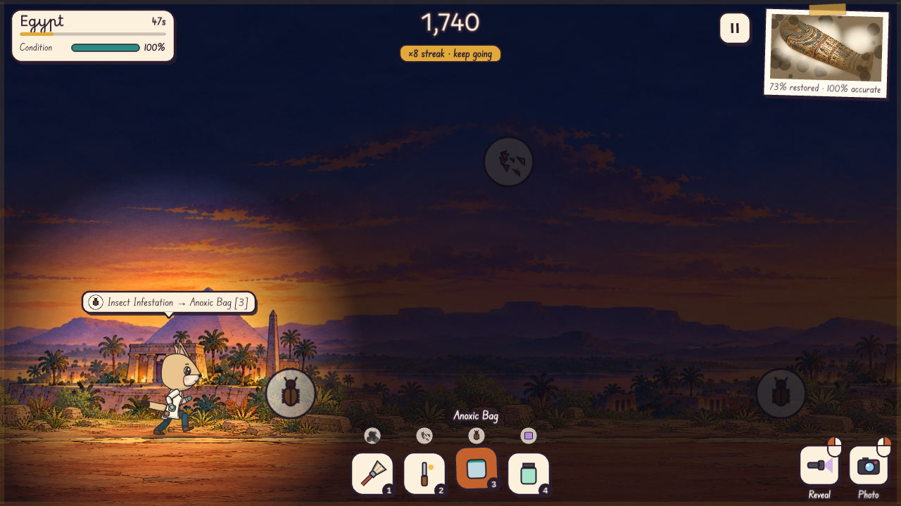 | 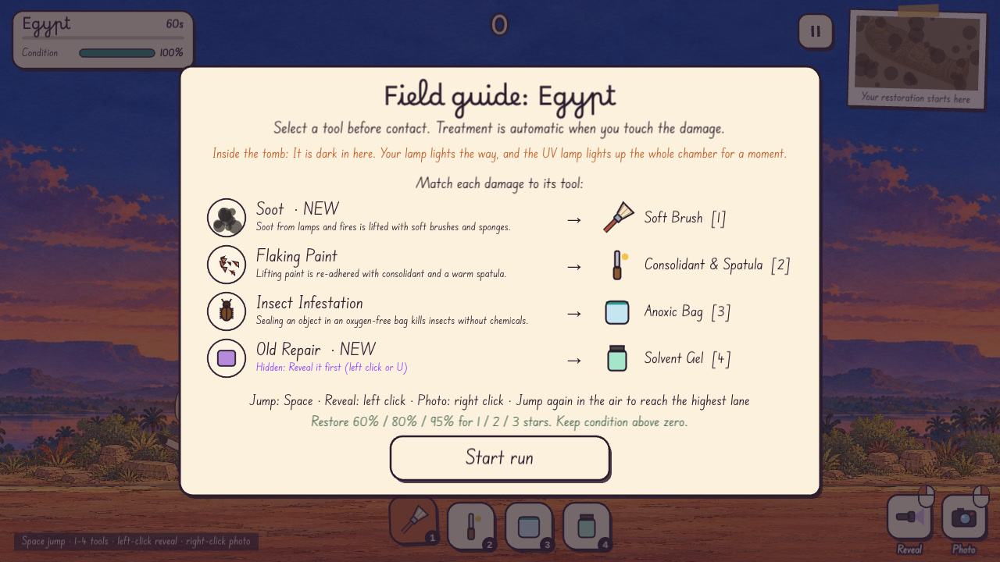 |
| **Egypt** · inside the tomb, lit by your lamp | **The field guide** · every damage, every tool |
| 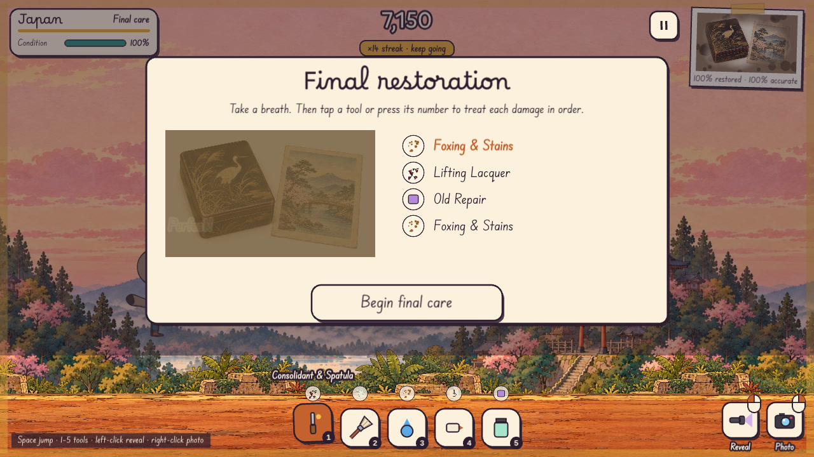 | 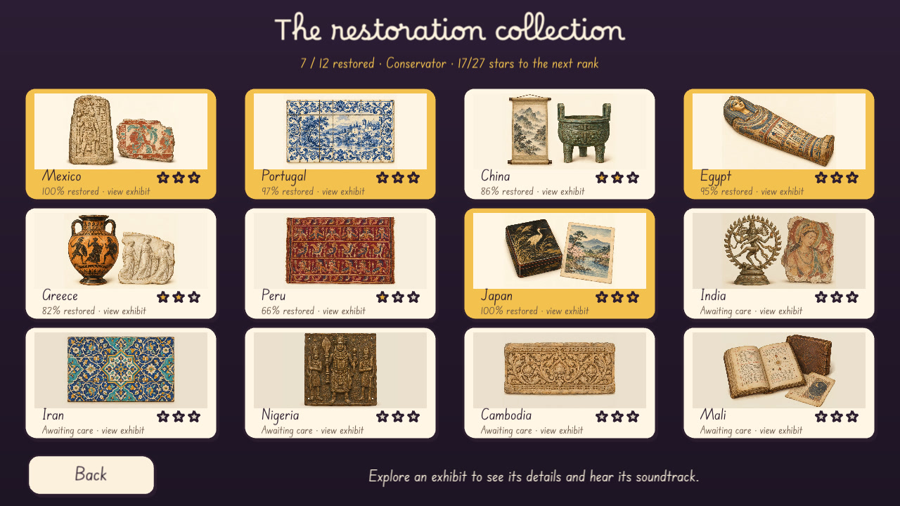 |
| **Final care** · the artifact itself, against the clock | **The museum** · your restorations on show |

<details>
<summary><b>More screenshots</b></summary>
<br>

| | |
|:---:|:---:|
| 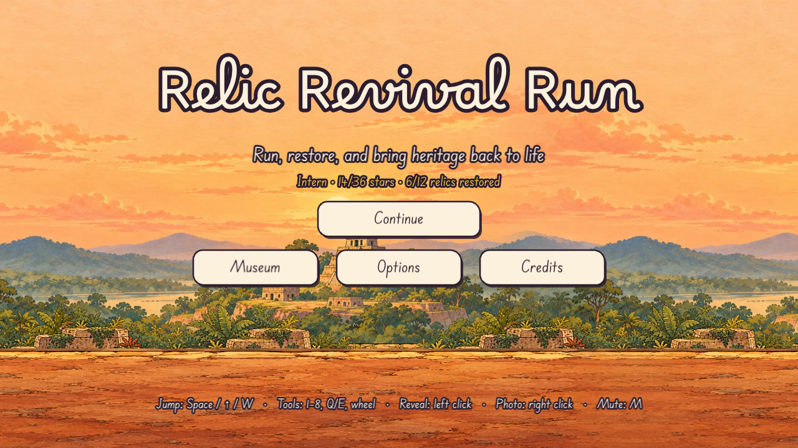 | 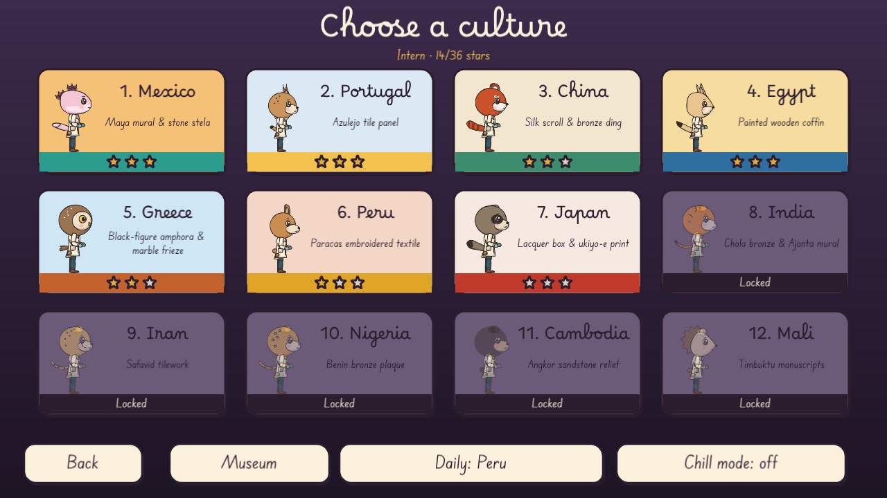 |
| 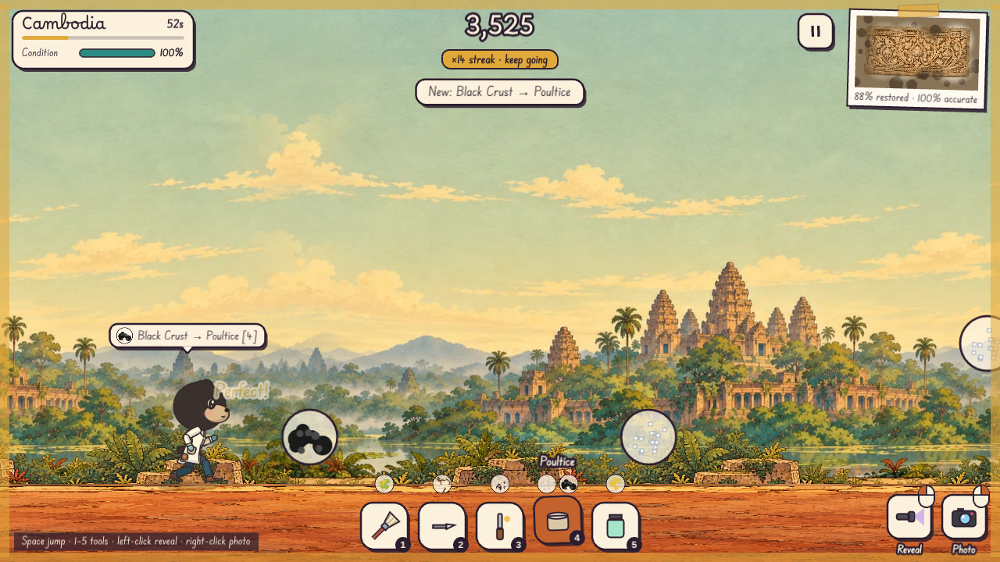 | 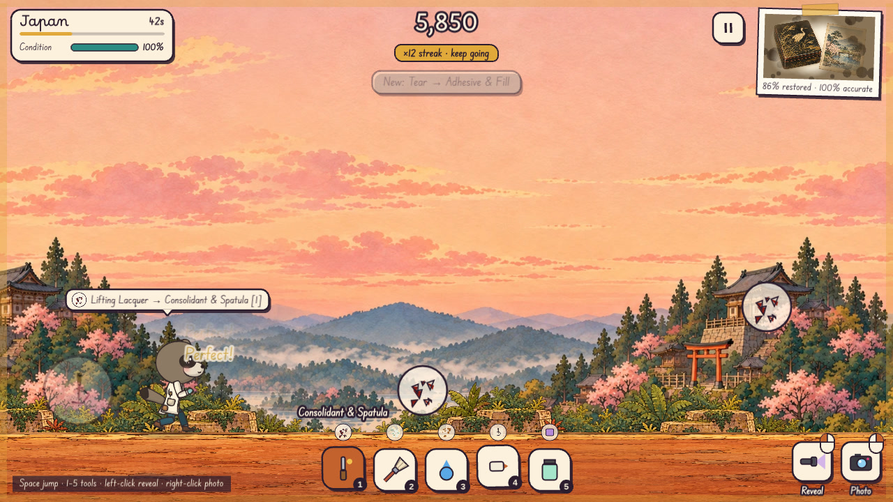 |
| 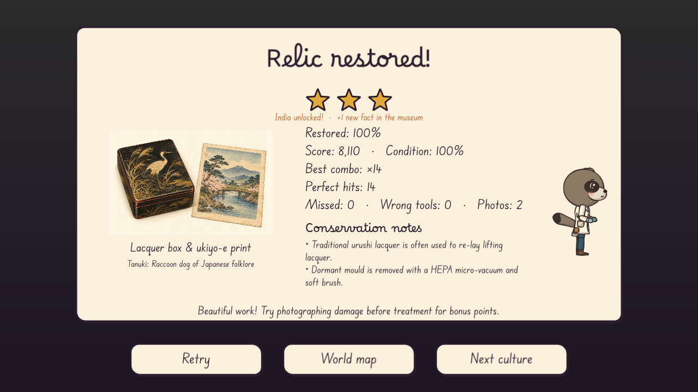 | 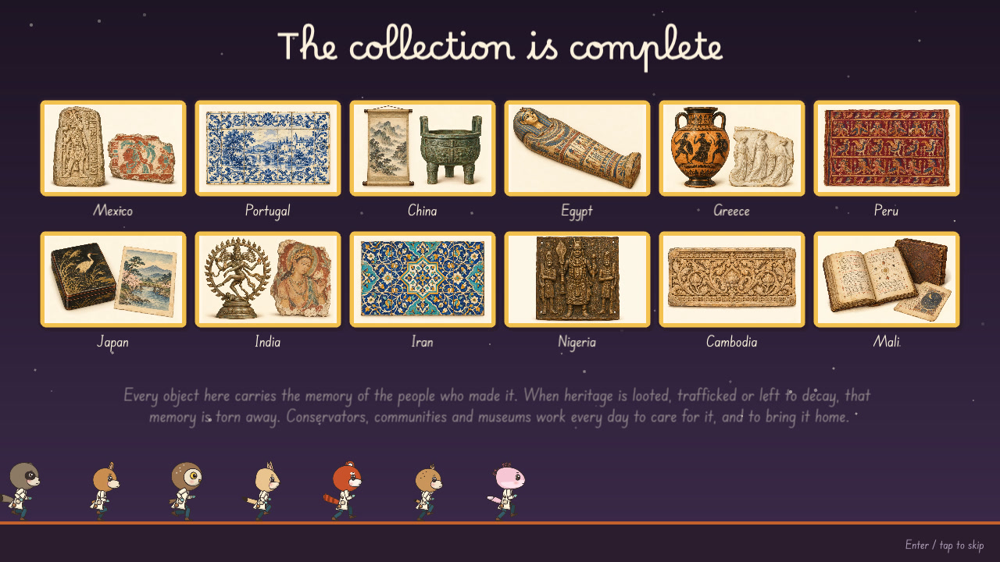 |

</details>

## Features

- **12 cultures, rising difficulty.**
  - **Cultures:** Mexico, Portugal, China, Egypt, Greece, Peru, Japan, India, Iran, Nigeria, Cambodia, Mali.
  - **Artifacts and damage:** each culture has its own artifact and damage types drawn from real conservation problems (salt efflorescence, bronze disease, foxing, insect infestation, and more).
- **Tools that match real practice.** Poultices draw out salts, an anoxic bag treats insects, a solvent gel removes old repairs. A UV lamp reveals hidden damage, and a camera documents it before treatment.
- **The game teaches its rules.** A field guide before every run, a tool-bar legend, tool hints, and feedback on every mistake.
- **A field-journal HUD that leaves the art visible.** Small paper slips at the screen edges carry time, condition, score and the artifact (a taped polaroid that clears as you restore it); a tag above the restorer names the next damage and its tool; a compact tool belt replaces the old full-width bar. Losing focus pauses the run.
- **Room to learn.** Runs last 55–75 seconds, with extra spacing for lane changes. Final care waits until you are ready; restore 60% / 80% / 95% while preserving condition to earn 1 / 2 / 3 stars.
- **A soundtrack written for each culture.** Every culture plays in its own tradition's meter, rhythm cycle and ensemble roles: a Mexican son in 6/8 against 3/4, fado's sung line and guitarra replies, Egyptian maqsum, Greek syrtos, huayno, teental with a tihai, a Persian reng, Nigerian call and response over the standard bell, Khmer pinpeat, the Mande kora's kumbengo, and more. Original themes, idiomatic ornaments and a player's timing. It stays reactive: the tune is always complete, and accompaniment, counter-voices and drums join as your combo grows; low condition adds tension. See [the soundtrack research](art/soundtrack-research.md).
- **A story with an ending.** A short prologue sets out why the restorers are running. Restore all twelve relics to complete the collection: the ending gathers every artifact and closes with the game's message about looted and trafficked heritage, followed by the credits (replayable from the title screen).
- **Progress worth chasing.** Best stars, restoration and score per culture; curator ranks; "new best" and "culture unlocked" news on the results card.
- **An illustrated museum.** Twelve artifact illustrations show the objects you are restoring, with enlarged exhibits, conservation notes, and full-arrangement soundtrack previews.
- **Controls for every player:** jump on the keyboard (Space/W/↑), tools on 1–8, Q/E or the wheel, and the mouse buttons for the utilities: **left click reveals (UV lamp), right click photographs**. Touch screens tap to jump and get on-screen Reveal/Photo buttons; gamepads, remappable keys, menus you can navigate without a mouse, and reduced-motion support.
- **Options** from the title and pause menus: music and effects volume, sound on/off, tool hints, chill mode, controls, and a two-step progress reset. The pause menu can also restart a run.

## Controls

| | Keyboard and mouse | Touch | Gamepad |
|---|---|---|---|
| **Jump** (again in the air: double jump) | Space / W / ↑ | Tap the scene | A, D-pad ↑ |
| **Pick a tool** | 1–8, Q / E, mouse wheel | Tap a tool | LB / RB, D-pad ← / → |
| **Reveal** hidden damage (UV lamp) | **Left click** (or U) | Reveal button | RT or Y |
| **Photograph** damage before treating it | **Right click** (or C) | Photo button | LT or X |
| **Pause** | Esc / P | Pause button | Start / Select |

Keys can be remapped in Options; M mutes anywhere.

## The twelve cultures

<p align="center">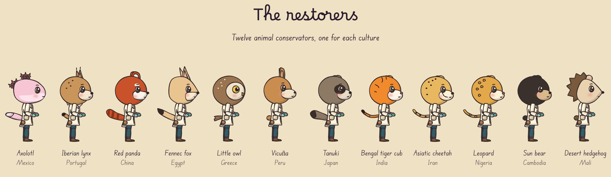</p>

<details>
<summary><b>Who restores what, and each culture's twist</b></summary>
<br>

| | Culture | Restorer | Artifact | Twist |
|---:|---|---|---|---|
| 1 | Mexico | Axolotl | Maya mural & stone stela | First steps |
| 2 | Portugal | Iberian lynx | Azulejo tile panel | Missing tiles |
| 3 | China | Red panda | Silk scroll & bronze ding | Mountain wind |
| 4 | Egypt | Fennec fox | Painted wooden coffin | Inside the tomb |
| 5 | Greece | Little owl | Black-figure amphora & marble frieze | Fragile pieces |
| 6 | Peru | Vicuña | Paracas embroidered textile | Thin mountain air |
| 7 | Japan | Tanuki | Lacquer box & ukiyo-e print | Lacquer precision |
| 8 | India | Bengal tiger cub | Chola bronze & Ajanta mural | Festival crescendo |
| 9 | Iran | Asiatic cheetah | Safavid tilework | Missing tiles |
| 10 | Nigeria | Leopard | Benin bronze plaque | Call and response |
| 11 | Cambodia | Sun bear | Angkor sandstone relief | Jungle regrowth |
| 12 | Mali | Desert hedgehog | Timbuktu manuscripts | Harmattan sandstorm |

<p align="center">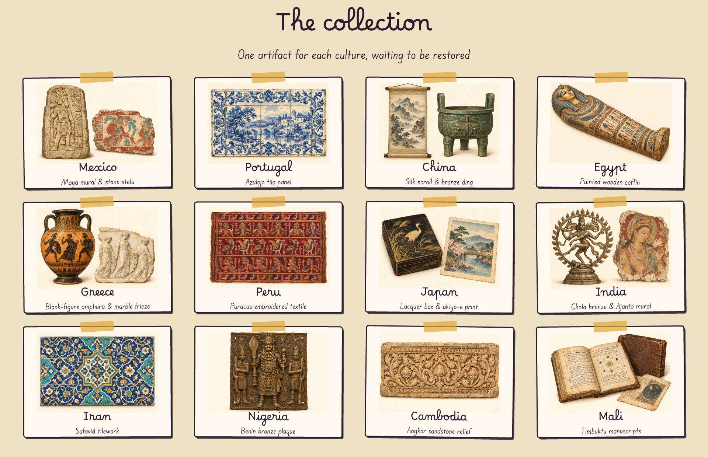</p>

</details>

## Development

The game uses Phaser 3, TypeScript and Vite. Everything runs in Docker:

```sh
docker compose up app                              # dev server on http://localhost:5173
docker compose run --rm app npm test               # unit tests
docker compose run --rm app npm run package:itch   # release/relic-revival-run-web.zip (itch.io HTML5)
docker compose run --rm win                        # Windows portable + installer in release/
```

Releases publish automatically: pushing a `v*` tag on a commit that is on `main` (for example `git tag v0.2.0 && git push origin v0.2.0`) runs `.github/workflows/itch.yml`, which tests, builds and uploads the web game to [itch.io](https://echoness.itch.io/relic-revival-run-remake) with butler. It needs a `BUTLER_API_KEY` repository secret.

The [media kit](media/README.md) is generated from the game: `node scripts/media-kit.cjs` redraws the banners, logos, store art and character renders, and captures fresh screenshots and gameplay video (see the kit's README).

The avatar workshop, a dev-only tool for drawing the cut-out characters, runs at http://localhost:5173/tools/workshop/.

`scripts/review-gameplay.cjs` runs a Playwright smoke test against the dev server, covering touch controls, pause menus, options, restart, focus loss, the end-of-run transition, final care, results, and the ending and credits. Set `PLAYWRIGHT_MODULE` to the installed Playwright module, `GAME_URL` to the dev server, and `REVIEW_OUT` to the screenshot directory. Balance regression tests in `tests/difficulty.test.ts` cover every culture's pacing and survival at 80% accuracy.

The animated cast and all twelve illustrated backgrounds can be reviewed at
http://localhost:5173/tools/art-preview/. See [the art notes](art/README.md) for
editable sources, generated concept provenance, and export instructions.

The development [music room](http://localhost:5173/tools/music-preview/) lets you
compare all twelve scores at different combo and condition settings.
Each culture's arrangement is written as data in `src/audio/styles.ts`: meter, A and B themes,
harmony, bass and accompaniment patterns, counter-voices and drum cycles, with the energy level at
which each part joins. `src/audio/score.ts` turns that into timed events (form A, A, B, A; ornaments;
swing and small human timing), and `AudioDirector` plays them on CC0 samples. These are original game
arrangements on substitute instruments, not reconstructions of traditional performances; the
research, sources and open questions are in [art/soundtrack-research.md](art/soundtrack-research.md).
`scripts/fetch-audio.mjs` fetches and peak-normalises the samples (`node scripts/fetch-audio.mjs balafon`
adds or refreshes a single instrument).

See [the researched museum/music plan](art/museum-music-plan.md) and
`scripts/review-museum-music.cjs` for the visual and audio review workflow. The
script uses Playwright and OfflineAudioContext to save museum screenshots, a full-cycle
stereo WAV of every culture (plus calm and danger mixes), and peak/RMS checks under ignored `docs/` output.

## Credits

<p>
  <picture>
    <source media="(prefers-color-scheme: dark)" srcset="media/logo/logo-on-dark.png">
    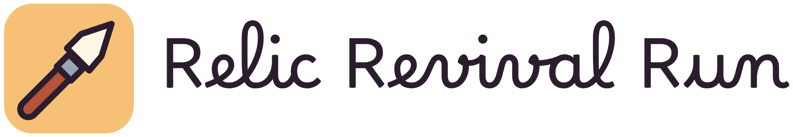
  </picture>
</p>

- **Remake:** Echo Yin.
- **Original game:** Studio Jojo.
- **Fonts:** [Borel](https://fonts.google.com/specimen/Borel) and [Edu SA Beginner](https://fonts.google.com/specimen/Edu+SA+Beginner), under the SIL Open Font License.
- **Instrument samples:** [Versilian Community Sample Library](https://github.com/sgossner/VCSL) (CC0); see `public/assets/audio/CREDITS.md`.
- **Press and store art:** the [media kit](media/README.md).

## License

- **Code** is under the [PolyForm Noncommercial License 1.0.0](LICENSE).
- **Art and audio** are under [CC BY-NC 4.0](LICENSE-ASSETS).
- **Fonts, bundled libraries and third-party audio clips** keep their own licenses (see `LICENSE-ASSETS`).
- The original 2023 jam release remains under the MIT license it was published with.
