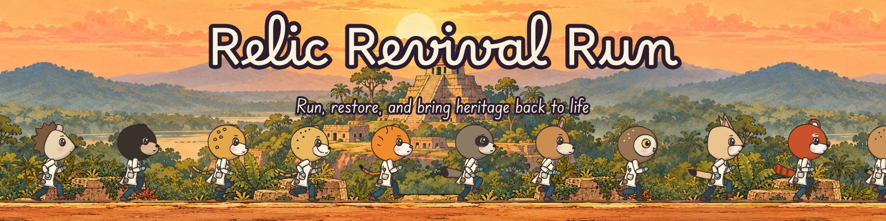
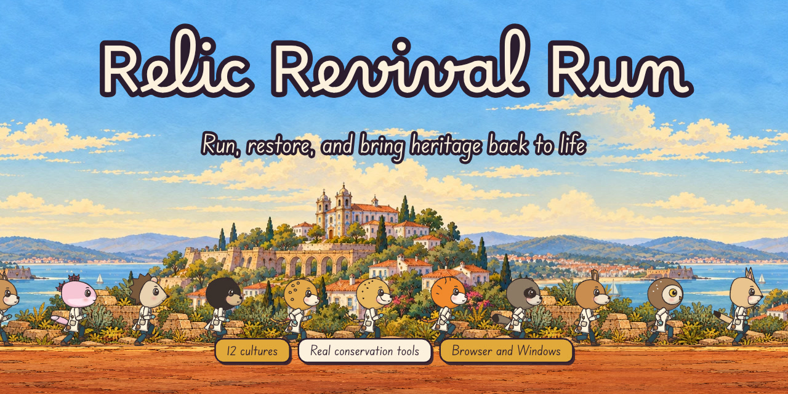
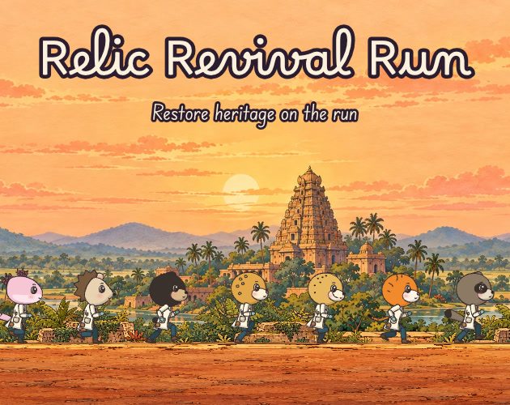
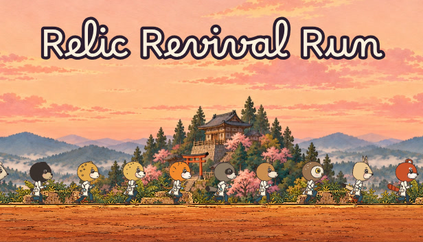
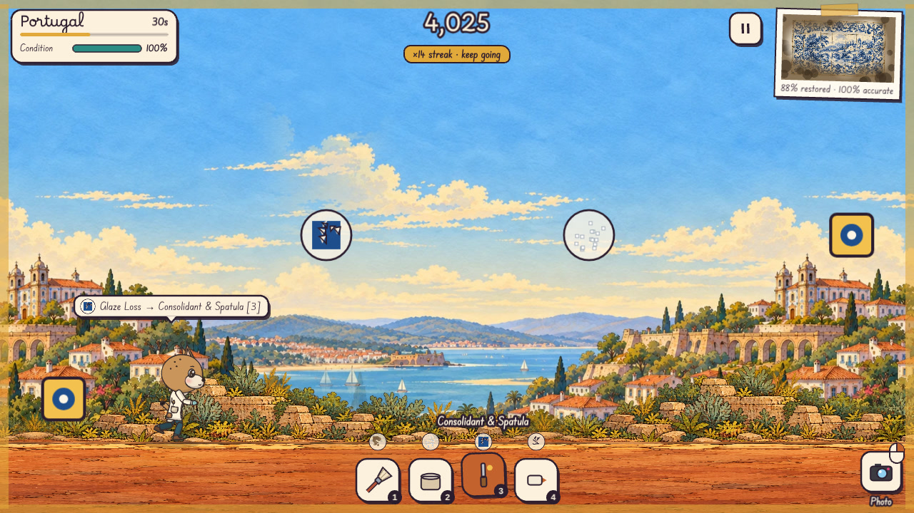

<p align="center"></p>

# Media kit

Everything here is drawn from the game itself: its illustrated landscapes, its cut-out restorers, its artifact paintings and its two typefaces. Use it to write about, stream, list or show Relic Revival Run.

**Contents:** [Fact sheet](#fact-sheet) · [Descriptions](#descriptions) · [Logo and icon](#logo-and-icon) · [Banners](#banners-and-social-images) · [Store art](#store-art) · [Screenshots](#screenshots) · [Video](#video-and-animation) · [Characters](#characters) · [Artwork](#artwork) · [Usage](#using-these-files) · [Regenerating](#regenerating-the-kit)

## Fact sheet

| | |
|---|---|
| **Title** | Relic Revival Run |
| **Genre** | Rhythm runner about restoring cultural heritage |
| **Remake** | Echo Yin, 2026 |
| **Original** | Studio Jojo, 2023, made for the [Mini Game Work Jam](https://itch.io/jam/mini-game-work-jam-2023), a jam against the illicit traffic of cultural property |
| **Platforms** | Web browser (HTML5); Windows (portable and installer) |
| **Status** | In development |
| **Content** | 12 cultures, 12 animal restorers, 20 kinds of real conservation damage, 8 treatment tools plus a UV lamp and a camera |
| **Controls** | Keyboard and mouse, touch, gamepad; remappable keys |
| **Original game** | [paoowo.itch.io/relic-revival-run](https://paoowo.itch.io/relic-revival-run) |
| **Source** | [github.com/e-choness/relic-revival-run](https://github.com/e-choness/relic-revival-run) |

## Descriptions

**One line:** Run through twelve cultures as an animal art restorer, and match the right conservation tool to each kind of damage to bring masterpieces back to life.

**Short (≈50 words):** Relic Revival Run is a rhythm runner about cultural heritage. As one of twelve animal conservators, you run from Mexico to Mali, treating salt, soot, insects, bronze disease and old repairs with the tools real conservators use. Hit damage on the beat, keep the artifact's condition, and fill the museum.

**Long:** Every object in Relic Revival Run carries the memory of the people who made it, and every one of them is in trouble: grime on a Maya stela, salts in Portuguese azulejos, insects in a Paracas textile, bronze disease on a Chola bronze. Choose the right treatment before you reach each spot (a poultice draws out salts, an anoxic bag treats insects, a solvent gel lifts an old repair), reveal hidden damage with the UV lamp and photograph it before you treat it. Damage arrives on the beat of each culture's own soundtrack, each culture after Mexico adds its own twist, and a final careful restoration ends each run. Restored artifacts go on show in the museum with the conservation notes you have learned. The game is a remake of Studio Jojo's 2023 jam game, made for a jam that advocates against the illicit traffic of cultural property.

## Logo and icon

| File | Size | Use |
|---|---|---|
| [`logo/logo-on-dark.png`](logo/logo-on-dark.png) | transparent | Paper lettering with an ink outline: on artwork, photos and dark backgrounds |
| [`logo/logo-on-light.png`](logo/logo-on-light.png) | transparent | Ink lettering: on white or light backgrounds |
| [`logo/icon.svg`](logo/icon.svg) | vector | The restorer's brush; the game's favicon and app icon |
| `logo/icon-{1024,512,256,128,64,32}.png` | square | The same icon as PNG |

<p> &nbsp; </p>

Please keep the logo's proportions and colours, and leave some clear space around it.

## Banners and social images

| File | Size | Use |
|---|---|---|
| [`banners/readme-banner.jpg`](banners/readme-banner.jpg) | 1600 × 400 | Repository and article headers |
| [`banners/banner-animated.gif`](banners/banner-animated.gif) | 1200 × 300, 8 s loop | The cast running past the pyramid, seamless loop |
| [`banners/banner-animated.mp4`](banners/banner-animated.mp4) | 1200 × 300, 8 s | The same loop as video |
| [`social/social-preview-1280x640.jpg`](social/social-preview-1280x640.jpg) | 1280 × 640 | GitHub social preview, Open Graph / link cards |
| [`social/header-1500x500.jpg`](social/header-1500x500.jpg) | 1500 × 500 | Profile headers (X, Bluesky, Mastodon) |



## Store art

| File | Size | Use |
|---|---|---|
| [`store/itch-cover-630x500.jpg`](store/itch-cover-630x500.jpg) | 630 × 500 | itch.io cover image |
| [`store/capsule-616x353.jpg`](store/capsule-616x353.jpg) | 616 × 353 | Main capsule |
| [`store/capsule-460x215.jpg`](store/capsule-460x215.jpg) | 460 × 215 | Small capsule / header |

<p> </p>

## Screenshots

1280 × 720, taken from the game as it runs (the gameplay ones with a simple autopilot at the controls).

| | |
|---|---|
|  |  |
|  |  |
|  |  |
|  |  |
|  |  |
|  | |

## Video and animation

| File | Size | |
|---|---|---|
| [`video/gameplay.mp4`](video/gameplay.mp4) | 1280 × 720, 30 fps, 10 s | A stretch of a Portugal run |
| [`video/gameplay.gif`](video/gameplay.gif) | 560 × 315, 12 fps, 6 s | The first 6 s, for places that only take images |
| [`banners/banner-animated.gif`](banners/banner-animated.gif) | 1200 × 300 | See [banners](#banners-and-social-images) |


## Characters

| File | |
|---|---|
| [`characters/cast-sheet.jpg`](characters/cast-sheet.jpg) | All twelve restorers with their names and cultures |
| [`characters/lineup.png`](characters/lineup.png) | All twelve in a row, transparent |
| `characters/NN-<culture>-<animal>.png` | Each restorer alone, about 800 px tall, transparent |


## Artwork

| File | |
|---|---|
| [`artwork/collection.jpg`](artwork/collection.jpg) | The twelve artifacts, taped into the journal |
| [`artwork/landscapes.jpg`](artwork/landscapes.jpg) | The twelve illustrated settings |
| [`artwork/palette.png`](artwork/palette.png) | The interface palette |


## Using these files

- **Coverage, previews, streams, store and festival listings:** go ahead. Please credit *Relic Revival Run by Echo Yin, remake of the original by Studio Jojo*.
- **Licence:** the art is under [CC BY-NC 4.0](../LICENSE-ASSETS): non-commercial use with attribution. Ask before using it in anything sold or sponsored.
- The landscapes and artifacts are illustrations made for the game, not photographs of real objects or archaeological reconstructions; please don't present them as such. Their provenance is recorded in [`art/`](../art/README.md).
- Fonts in the images: [Borel](https://fonts.google.com/specimen/Borel) and [Edu SA Beginner](https://fonts.google.com/specimen/Edu+SA+Beginner) (SIL Open Font License).

## Regenerating the kit

The kit is generated, so it stays in step with the game. With the dev server running (`docker compose up app`):

```sh
docker compose run --rm app node scripts/media-kit.cjs           # everything
docker compose run --rm app node scripts/media-kit.cjs studio    # banners, logos, store art, characters, artwork
docker compose run --rm app node scripts/media-kit.cjs game      # screenshots and gameplay video
```

Set `PLAYWRIGHT_MODULE` and `GAME_URL` as for the other review scripts; ffmpeg is in the Docker image. The drawn assets come from the dev-only studio page at http://localhost:5173/tools/media-kit/ (`tools/media-kit/main.ts`); the game captures step the game at a fixed 30 fps, so every regeneration gives the same frames.
